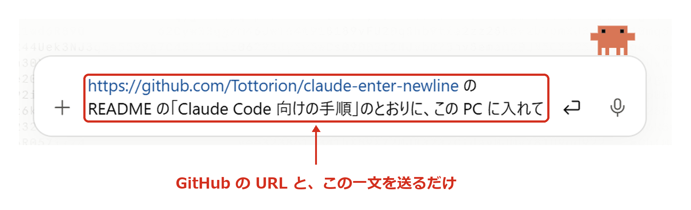

# Claude のデスクトップアプリで Enter を改行にする（Windows）

Claude のデスクトップアプリの入力欄を、次のように変える AutoHotkey v2 のスクリプトです。Claude の窓の中だけで効きます。

| 押すキー | 今まで | 入れた後 |
|---|---|---|
| Enter | 送信 | 改行 |
| Ctrl+Enter | — | 送信（Ctrl を離した時に送る） |
| 日本語の変換中の Enter | 確定 | 確定（今まで通り） |

## Claude Code に頼んで入れる

Claude のデスクトップアプリの Code タブで、次の一文を送るだけです。



```
https://github.com/Tottorion/claude-enter-newline の README の「Claude Code 向けの手順」のとおりに、この PC に入れて
```

Claude Code が、入れる物と置き場所を説明してから入れます。AutoHotkey は公式の持ち運び版を使うので、インストールと管理者権限は要りません。

## 確かめ方

Claude の入力欄で、次の4つを試してください。

1. 日本語を打って Enter を押すと、確定だけされる
2. もう一度 Enter を押すと、改行される
3. スペースで漢字に変換して Enter を押すと、確定だけされる
4. Ctrl+Enter を押すと、Ctrl を離した時に送信される

## 止める・やめる

- 止める: タスクバー右下の緑の「H」を右クリックし、「Exit」
- やめる: Win+R で `shell:startup` を開き、`Claude_Enter.lnk` を消す。パソコンを起動し直すと元に戻る

## 確かめた環境と、分かっている制限

- 確かめた環境: Windows 11・Microsoft IME・Claude デスクトップアプリ 2.42304・AutoHotkey 2.0.30（2026-10-17）
- Google 日本語入力・ATOK では確かめていません
- 予測の窓を Esc で閉じてから Backspace を押した後などは、Enter を押しても何も起きないことがあります。文字は消えず、送信もされません。下線が付いたままなら Ctrl+Enter で確定できます（下線がある間は送信されません）
- 許可を求めるカードなど、Claude の窓の中で Enter で押していた所も改行の扱いになります。クリックか Ctrl+Enter で押してください
- Ctrl+Enter は、Ctrl を離した時に送ります。先に送ると Ctrl を押し直すことになり、Ctrl 2回で開く常駐ソフト（Clibor など）が反応するためです

## しくみ（Enter を Shift+Enter に置き換えるだけでは駄目な理由）

- Microsoft IME は、変換中の Shift+Enter を無視します。置き換えるだけだと、変換中に Enter を押しても確定しません
- 日本語入力をいったん閉じると、変換中の文字は確定されずに消えます。「閉じて確定してから改行」もできません
- そこで、次のどちらかなら変換中とみなし、Enter をそのまま通して確定させます
  - 候補の窓（`mscandui*.candidate`）が Claude の窓のプロセスに見えている（入力中は1文字目から出る）
  - 直前に Space・変換・F6〜F10・Esc を押した（変換した後や候補を閉じた後は窓が消えるが、変換中は続いている）
- 見分けられなかった時は Shift+Enter にします。変換中なら IME が無視するので、間違って送信されることはありません

## Claude Code 向けの手順

1. 入れる前に、利用者に次を伝えて許可をもらう
   - AutoHotkey v2 の公式の持ち運び版を `%USERPROFILE%\Tools\AutoHotkey` に置く（インストールと管理者権限は不要）
   - スタートアップに `Claude_Enter.lnk` を1つ作り、パソコンを起動したら自動で動くようにする
2. 置き場所は AppData の外にする。Claude のデスクトップアプリは Windows のパッケージアプリで、そこから動かしたプログラムが AppData の下に新しく作ったファイルは、利用者には見えない別の場所に回される。スタートアップのフォルダは回されない
3. PowerShell で次を動かす。AutoHotkey の zip は、GitHub のリリース情報の SHA256 と照らし合わせてから展開する

   ```powershell
   $ver = "2.0.30"
   $dir = "$env:USERPROFILE\Tools\AutoHotkey"
   New-Item -ItemType Directory -Force $dir | Out-Null
   $zip = "$dir\AutoHotkey_$ver.zip"
   Invoke-WebRequest "https://github.com/AutoHotkey/AutoHotkey/releases/download/v$ver/AutoHotkey_$ver.zip" -OutFile $zip
   $digest = ((Invoke-RestMethod "https://api.github.com/repos/AutoHotkey/AutoHotkey/releases/tags/v$ver").assets | Where-Object name -eq "AutoHotkey_$ver.zip").digest
   if (("sha256:" + (Get-FileHash $zip -Algorithm SHA256).Hash.ToLower()) -ne $digest) { throw "SHA256 が合わない" }
   Expand-Archive $zip $dir -Force
   Remove-Item $zip
   Invoke-WebRequest "https://raw.githubusercontent.com/Tottorion/claude-enter-newline/main/Claude_Enter.ahk" -OutFile "$dir\Claude_Enter.ahk"
   $lnk = Join-Path ([Environment]::GetFolderPath('Startup')) "Claude_Enter.lnk"
   $s = (New-Object -ComObject WScript.Shell).CreateShortcut($lnk)
   $s.TargetPath = "$dir\AutoHotkey64.exe"
   $s.Arguments = "`"$dir\Claude_Enter.ahk`""
   $s.WorkingDirectory = $dir
   $s.Save()
   Start-Process explorer.exe "`"$lnk`""
   ```

4. 最後の行で、Claude の外（エクスプローラー）から起動している。`Get-CimInstance Win32_Process -Filter "Name='AutoHotkey64.exe'"` で、`Claude_Enter.ahk` を開いた AutoHotkey64.exe が1つだけ動いているのを確かめる
5. Claude の窓は Claude Code からは操作できない。利用者に「確かめ方」の4つを試してもらう

## ライセンス

MIT
